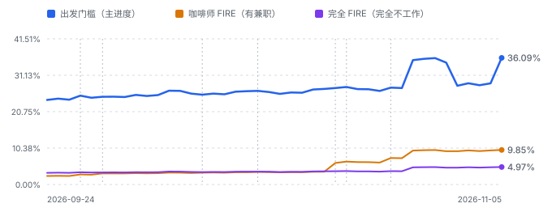
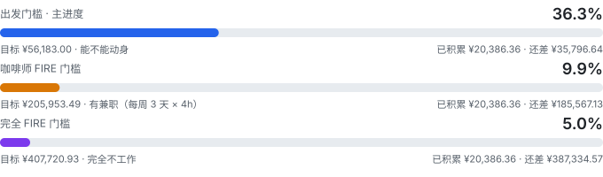
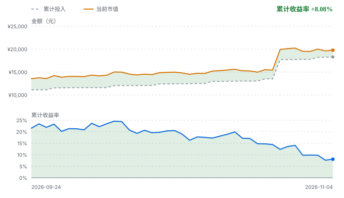

# FIRE-Progress

> 我的 FIRE 进度看板。只统计三项长期不动用的资产：比特币、标普500基金、纳指100基金。
> 持仓来自两个公开仓库 + 东方财富的公开净值接口，由 GitHub Actions 每小时更新，不需要任何密钥。
>
> **网页版**（手机上直接看）：<https://sayangchun.github.io/FIRE-Progress/>
>
> 各数字的出处见 [详细文档](#详细文档)：五份文档，一份讲[**为什么做这件事**](docs/FIRE-WHY.md)，四份分别覆盖生活规划、时间线、支出清单与实现细节。

<!-- FIRE:START -->

**更新时间**：2026-11-05 10:22:23+08:00

**比特币快照**：2026-11-01（4 天前）　|　**基金净值日**：2026-11-03

### 进度曲线

> 三条线回答三个问题：**出发门槛**（能不能走，主进度）= 医疗应急 + 搬家 + 空窗；**咖啡师 FIRE**（有兼职）= (月开销 − 兼职净收入) × 12 ÷ 提取率；**完全 FIRE**（完全不工作）= 月开销 × 12 ÷ 提取率。别把它们混成一个百分比。
>
> 每个点是当天的完成度原值，按 `data/history.json` 连线，不回填、不重算。竖虚线是口径调整日——那天目标变了，所以出现台阶。
>
> ⚠️ 出发门槛 2026-10-31 才定义，此前的点是按当前门槛折算的**反事实**，不是历史记录；它不含行情，只由医疗应急、搬家、月开销决定。
>
> ⚠️ 分子口径也变过，但不画竖线（竖线只标分母）：2026-10-27 起分子纳入纳指100（当日跳升约 2.1 个点属口径变化，非资产增长）。

| 指标 | 数值 |
| --- | ---: |
| 🚪 出发门槛（★ 主进度） · 能不能动身 | ¥56,183.00 |
| ☕ 咖啡师 FIRE 门槛 · 有兼职（每周 3 天 × 4h） | ¥205,953.49 |
| 🎯 完全 FIRE 门槛 · 完全不工作 | ¥407,720.93 |
| 🚪 出发门槛上沿（更保守） | ¥110,566.00 |
| 💰 当前资产 | ¥20,464.85 |
| 📈 出发门槛完成度（★ 主进度） | **36.425%** |
| 📈 咖啡师 FIRE 门槛完成度 | **9.937%** |
| 📈 完全 FIRE 门槛完成度 | **5.019%** |
| ☕ 兼职净收入（月） | ¥723.00 |
| 🧾 组合需覆盖（月，咖啡师 FIRE） | ¥738.00 |
| ⏳ 距离咖啡师 FIRE 门槛 | ¥185,488.64 |
| ⏳ 距离主进度（出发门槛） | ¥35,718.15 |
| ⏱️ 每小时被动收入（按预期年化） | ¥0.24 |

> **三个门槛别混成一个百分比。** 出发门槛答「能不能动身」（阶段 A 有工作，只需医疗应急 + 搬家 + 空窗）；咖啡师 FIRE 答「能不能只做兼职」（资产覆盖 ¥738/月）；**完全 FIRE 答「能不能完全不工作」（资产覆盖全额 ¥1,461/月，不依赖任何劳动收入）**。主进度由 `display.primary_progress` 指定，改一行即可切换。

阶段 A 首选方案 · 全职 · 图书馆保安（牡丹江，独自租房）

**¥17/小时 × 40 小时/周 = 毛收入 ¥2,946.67/月**，扣交通 ¥43.33、餐食 ¥154.00、装备 ¥10.00，净 **¥2,739.33/月**。月开销 ¥1,461.00，**盈余 ¥1,278.33**（等效时薪 ¥14.05，每月占用 195 小时）。

> 盈余若从现在起并入定投（月投 ¥3,846.39），按基准年化 **10.45%** 外推，约 **3.22 年**后达到咖啡师 FIRE 门槛（2030-01-24）；不做全职则 4.41 年（2031-04-03）。
>
> ⚠️ 敏感性测算，不是承诺：假设这份工作今天就有、盈余全部存下（实际要到 2029-06 毕业才可能开始）。全职**不改变** FIRE 目标，只影响「多久到」。

FIRE 后月开销明细 · 牡丹江 · 单人 · 租房 · 极简

共 **17 项**，合计 **¥1,461.00/月**。

| 分类 | 项目 | 月支出 |
| --- | --- | ---: |
| 住房与水电燃气 | 房租 | ¥500.00 |
|  | 取暖费 | ¥75.00 |
|  | 物业费 | ¥15.00 |
|  | 水费 | ¥12.00 |
|  | 电费 | ¥55.00 |
|  | 燃气/液化气 | ¥35.00 |
|  | 家电维修与更换摊销 | ¥20.00 |
| 日常开销 | 网络与手机 | ¥30.00 |
|  | 食品 | ¥300.00 |
|  | 饮用水 | ¥15.00 |
|  | 日用品 | ¥22.00 |
|  | 交通 | ¥30.00 |
|  | 探亲与返乡交通 | ¥100.00 |
|  | 衣物 | ¥30.00 |
|  | 杂项（快递与小额） | ¥5.00 |
| 医疗与应急 | 医疗自付预留 | ¥80.00 |
|  | 应急与物价缓冲 | ¥137.00 |
| **合计** |  | **¥1,461.00** |

兼职 ¥15/小时 × 每周 12 小时：毛 ¥780.00 − 交通 ¥26.00 − 餐食 ¥25.00 − 装备 ¥6.00 = 净 **¥723.00/月**，组合需覆盖 **¥738.00/月**。

一次性支出（不摊进月开销）：租房押金 ¥1,000.00 + 搬家与长途运输 ¥800.00 = **¥1,800.00**，含一次性支出共 **¥207,753.49**。

> 只扣上班多出来的开销：餐食算的是「在外面吃比在家做贵多少」，家里那顿已经算在食品里，全额扣等于把生活费算两遍。
>
> 月开销 = 各项相加，`FIRE 目标 = (月开销 − 兼职净收入) × 12 ÷ 提取率`。每项依据见 [config.yaml](config.yaml) 与 [docs/FIRE-LIFE-PLAN.md](docs/FIRE-LIFE-PLAN.md)。

### 资产构成

| 资产 | 市值 | 占比 |
| --- | ---: | ---: |
| 比特币 | ¥15,178.13 | 74.2% |
| 标普500基金 | ¥979.97 | 4.8% |
| 纳指100基金 | ¥4,306.75 | 21.0% |
| **合计** | **¥20,464.85** | 100.0% |

> 只算长期不动用的钱：比特币、标普500基金、纳指100基金。日常现金和活期不算。所以卖出后进度下跌未必是亏了，可能只是钱变成了现金，详见下方「计入范围」。

比特币计价：**0.02812354 BTC** × ¥539,694.78 = ¥15,178.13

比特币持仓明细（快照 2026-11-01，手动更新）

| 账户 | 数量 (BTC) | 均价 (USD) |
| --- | ---: | ---: |
| 币安 | 0.01016574 | $69,618.88 |
| 欧易 | 0.0179578 | $70,026.25 |

标普500基金持仓明细

| 基金 | 市值 | 累计投入 | 持有份额 | 最新净值 |
| --- | ---: | ---: | ---: | ---: |
| 摩根标普500 A | ¥489.82 | ¥499.50 | 293.62 | 1.6682 |
| 摩根标普500 C | ¥490.15 | ¥500.00 | 296.79 | 1.6515 |

纳指100基金持仓明细（净值日 —，份额固定，已停止定投）

| 基金 | 市值 | 累计投入 | 持有份额 | 最新净值 |
| --- | ---: | ---: | ---: | ---: |
| 天弘纳斯达克100指数发起(QDII)A | ¥2,567.57 | ¥2,317.08 | 1330.28 | 1.9301 |
| 国泰纳斯达克100指数 | ¥1,212.83 | ¥1,300.01 | 287.06 | 4.2250 |
| 华安纳斯达克100ETF联接(QDII)A | ¥526.35 | ¥560.13 | 68.00 | 7.7405 |

### 投入与盈亏

| 指标 | 数值 |
| --- | ---: |
| 累计投入本金 | ¥18,315.21 |
| 当前市值 | ¥20,464.85 |
| 累计盈亏 | ¥2,149.64 |
| **累计收益率** | **+11.74%** |

> 比特币本金按持仓备注的「均价 $xx/BTC」推算，用当前汇率折成人民币，和真实买入成本有偏差；标普500本金取 sp500-dca 的累计投入。

### 收益曲线

> 上面板：累计投入（虚线）和市值（实线），缺口就是盈亏。下面板：累计收益率，纵轴含 0。
>
> 加仓会让收益率下降，因为本金变大、盈亏不变。所以收益率掉了不一定是亏，可能只是又投了一笔。上面板能看出本金哪天跳升。
>
> 上面板纵轴不从 0 起，否则缺口会被压成一条线，斜率也不代表涨跌幅。下面板含 0，正负可以直接读。
>
> 起点 2026-09-24。早期数据由两个持仓仓库的历史文件重建，比特币统一按当前汇率折算，绝对值和真实本金有误差，趋势可信；之后每天由 Actions 记录。

### 每小时被动收入

| 资产 | 市值 | 权重 | 预期年化 | 每小时 |
| --- | ---: | ---: | ---: | ---: |
| 比特币 | ¥15,178.13 | 74.2% | 12.0% | ¥0.208 |
| 标普500基金 | ¥979.97 | 4.8% | 6.0% | ¥0.007 |
| 纳指100基金 | ¥4,306.75 | 21.0% | 6.0% | ¥0.029 |
| **合计** | **¥20,464.85** | 100.0% | **10.5%** | **¥0.244** |

换算：每小时 **¥0.24** · 每天 **¥5.86** · 每月 **¥178.22** · 每年 **¥2,138.58**

> 按当前持仓，这笔被动收入相当于月开销的 **12.2%**（月开销 ¥1,461.00）。
>
> 这是按假设算出来的数，不是承诺。加权年化 10.5% 由各资产按市值加权得到，假设写在 `config.yaml` 的 `expected_return` 段，改它不影响 FIRE 目标。
>
> 区间跨度大：悲观（比特币 0%、标普500基金 3%、纳指100基金 3%）每小时 ¥0.018，乐观（比特币 25%、标普500基金 9%、纳指100基金 9%）¥0.487。因为各资产的回报率假设本身就宽：比特币没有可锚定的现金流，长期回报率只能猜。
>
> 也别把 10.5% 当成能花的钱。预期回报是「平均能涨多少」，提取率是「能安全花多少」：按 4.3% 提取率算，同样这笔资产每小时 ¥0.100、每月 ¥73.33。
>
> 差额是给波动留的：平均回报为正，但路径上先腰斩一次，按平均回报安排支出就会在中途卖掉筹码。比特币单年 ±50% 是常态，两个数要一起看。

### 外推

按「定投 + 资产增值」外推：日投 **¥86.19**（月 ¥2,585.57，比特币 9.9 USDT + 标普500 ¥20.00），叠加当前持仓按加权预期年化 **10.45%** 增长，**约 4.4 年**后达到**咖啡师 FIRE 门槛**（2031-04-03）。

> 区间：悲观约 5.7 年（加权 0.77%） · 基准约 4.4 年 · 乐观约 3.6 年（加权 20.87%）。
>
> 这不再是线性外推：定投按天累加，已有持仓按年化复利。差距全部来自收益率假设——比特币占七成时，「平均收益率」对这个组合没有实际意义，路径才重要，上沿只能当参考。
>
> 定投额用真实值、不用近 30 天增速：那段增速由行情主导，涨得快不等于进度快，跌的时候还会被推成「永远达不到」。
>
> **阶段 A 若有全职收入**（净 ¥2,739.33/月，盈余 ¥1,278.33 并入定投 → 月投 ¥3,846.39），同一口径下 **约 3.2 年**（2030-01-24）。这是敏感性测算，不是承诺——它假设这份工作从现在就有。

数据源：[SayangChun/0.1BTC](https://github.com/SayangChun/0.1BTC)（比特币持仓，每周手动更新）、[SayangChun/sp500-dca](https://github.com/SayangChun/sp500-dca)（标普500 持仓）、东方财富（纳指100 净值，份额固定）· 行情：binance:api.binance.com · 汇率：open.er-api.com

<!-- FIRE:END -->

## 详细文档

看板上每个数字都能追到出处。五份文档各管一层：

| 文档 | 回答什么 | 使用场景 |
| --- | --- | --- |
| [**为什么 FIRE**](docs/FIRE-WHY.md) | **为什么做这件事**——动机、对工作的看法、**为什么一定要自己住**、对「这是逃避」这类质疑的回应 | 理解立场。**不参与计算**，不随口径变动 |
| [**FIRE 生活规划书**](docs/FIRE-LIFE-PLAN.md) | **怎么生活**——月开销 ¥1,461 的 17 项逐项依据、租房与饮食、不参保的代价 | 改预算、核对物价、评估定居城市 |
| [**两段式路线图**](docs/FIRE-ROADMAP.md) | **什么时候走、能撑多久**——2029-06 出发、阶段 A 长度敏感性、临界收益率 | 调整时间线、比较兼职方案 |
| [**支出候选清单**](docs/FIRE-SPENDING-CHECKLIST.md) | **花了什么**——130+ 项候选支出，逐项标注计入 / 不计入 / 待定 | 怀疑漏项、想加一笔新支出 |
| [**实现方案**](docs/DESIGN.md) | **怎么算的**——数据源、口径落点、自动化流程、README 生成规则 | 改代码、审计口径、接入新资产 |

后四份文档共用 [`config.yaml`](config.yaml) 的口径：改金额改 `life_plan`，改时间线改 `timeline`，均无需改动文档。**第一份（为什么 FIRE）不参与任何计算**，改口径时不用动它。但**改完需同步对应章节**，否则文档与看板会不一致（2026-10-27 曾出现执行清单仍写「赎回纳指」、而决定已改为不卖）。

## 计算口径

| 参数 | 取值 |
| --- | ---: |
| 月开销 | ¥1,461（由生活规划逐项推导） |
| 兼职净收入 | ¥723.00/月（仅咖啡师 FIRE 口径用） |
| **组合需覆盖（有兼职）** | **¥738.00/月** |
| 提取率 | 4.3% |
| **🚪 出发门槛（主进度）** | **¥56,183 – ¥110,566** |
| **☕ 咖啡师 FIRE 门槛** | **¥205,953.49** |
| **🎯 完全 FIRE 门槛（完全不工作）** | **¥407,720.93** |

三个门槛别混成一个百分比：

| 门槛 | 公式 | 回答什么 |
| --- | --- | --- |
| 出发门槛 | 医疗应急 + 搬家 + 空窗期月开销 | 能不能动身（阶段 A 有工作，现金流为正） |
| 咖啡师 FIRE | `(月开销 − 兼职净收入) × 12 ÷ 提取率` | 能不能只做兼职 + 靠资产补 ¥738/月 |
| **完全 FIRE** | `月开销 × 12 ÷ 提取率` | **能不能完全不工作**，资产覆盖全额 ¥1,461/月 |

⚠️ 以前只有一条叫「不工作门槛」的线，数值是 ¥205,953.49——但那是**有兼职**的口径，名字是错的。2026-11-05 起拆成两条，完全 FIRE 不扣任何劳动收入。

**主进度**默认用出发门槛（`display.primary_progress: departure`），以后要换只改 `config.yaml` 一行；三个门槛的金额、完成度和历史留档都不随开关变化。月开销由 `life_plan` 逐项相加，改一项三个门槛一起重算，依据见规划书 §6。

兼职净收入对应 `fire.labor_income`：FIRE 后继续做低压力、随时能停的兼职。只扣上班多出来的成本。把 `enabled` 改成 `false`，咖啡师 FIRE 门槛就与完全 FIRE 门槛相等（¥407,720.93）。

口径改过多次——换城市、改 FIRE 类型、砍掉医保、纳入纳指100、改两段式、改工作形态、拆开两个 FIRE 门槛……每一次的日期、原因和对目标的影响都记在[规划书 §12](docs/FIRE-LIFE-PLAN.md)，这里不重复。**每次变更都会让进度曲线出现台阶**：那是分母变了，不是资产涨了，`data/history.json` 逐日存了当时的 `target_cny` 与 `full_fire_cny`，可以查。

## FIRE 生活规划

按**牡丹江**口径计算（单人、租房、极简）。2026-11-05 排除北京后，牡丹江是唯一城市；换城市按规划书 §2.4 重算。

| 项目 | 结论 |
| --- | --- |
| 城市 / 落脚区 | 牡丹江 · 爱民区（2026-10 调研，未实地验证） |
| 月开销 | ¥1,461（17 项） |
| 阶段 A 收入 | 图书馆保安：¥17/h，净 ¥2,739.33，盈余 ¥1,278.33；找不到退回兼职 ¥723.00 |
| 组合需覆盖（有兼职） | ¥738.00 |
| 咖啡师 FIRE 门槛 | ¥205,953.49 |
| 完全 FIRE 门槛 | ¥407,720.93 |
| 一次性落地支出 | ¥1,800（押金 ¥1,000 + 运输 ¥800） |
| 含一次性支出的需求（咖啡师 FIRE） | ¥207,753.49 |
| 对照：常规档（咖啡师 FIRE） | ¥566,790.70 |

完整规划见 **[docs/FIRE-LIFE-PLAN.md](docs/FIRE-LIFE-PLAN.md)**：城市对比与选址、租房与「租 vs 买」（买房隐含回报 2.72%，低于 4.3% 提取率，所以租房更划算）、16:8 两餐的购物篮与营养表、不参保的代价、130+ 项支出判定、敏感性分析。

> ⚠️ ¥1,461 是下限，不是中位数。约 ¥75/月（体检、牙科）30 年内几乎必然发生，不计入的话真实目标更可能落在 ¥226,884 上下；每 ¥10/月约等于目标 ±¥2,791。候选清单见 [docs/FIRE-SPENDING-CHECKLIST.md](docs/FIRE-SPENDING-CHECKLIST.md)。
>
> ⚠️ 前提是不交社保、不参加任何医保：没有养老金、住院全自付，唯一防线是专项医疗应急金（¥50k–100k），见规划书 §5。

## 两段式路线

上面两个 FIRE 门槛都是**永续**口径（资产不耗尽），实际计划是两段式：

| | 阶段 A | 阶段 B |
| --- | --- | --- |
| 地点 | **牡丹江** | 北京 |
| 性质 | 一个人租房住，不回家、不合住 | 回归家庭，看护长辈 |
| 收入 | 图书馆保安净 ¥2,739/月；找不到退回兼职 ¥723 | 无 |
| 退出 | 长辈病情加重 → 回京，此后不再回来 | 长辈离世 → 继承 |

阶段 A 有工资，所以**出发不需要攒够 ¥205,953**。真正的出发条件是**出发门槛 ¥56,183–110,566**（医疗应急 ¥5–10 万 + 搬家 ¥1,800 + 空窗 3–6 个月）。毕业时约 ¥10 万，取下沿够——所以出发时点从 2031-04 提前到 **2029-06 毕业当月**，而到达 ¥205,953 的时点几乎不变。这笔钱同时是失业缓冲：按 ¥1,461/月可撑约 68 个月。

找不到全职、只剩兼职时，按年金现值算（毕业时约 ¥11 万本金）：每周 3 天 × ¥15 可撑 **18.1 年**（到 40.1 岁），4 天 × ¥17 则**永续**；分界线是外公约 95 岁，这件事无法提前知道。临界收益率分别是 8.05% 和 3.80%。

完整推演见 **[docs/FIRE-ROADMAP.md](docs/FIRE-ROADMAP.md)**。这一段不改变上面的目标与完成度，它回答的是另一个问题：这笔钱够不够撑到该回去的那天。

## 计入范围

- ✅ [0.1BTC](https://github.com/SayangChun/0.1BTC) 的比特币持仓
- ✅ [sp500-dca](https://github.com/SayangChun/sp500-dca) 的标普500基金
- ✅ 纳指100 场外基金（018043 / 160213 / 040046），份额写在 `config.yaml`，净值抓东方财富
- ❌ 日常现金、活期存款、其他币种、其他一切资产

划线标准是「长期不动用」，不是「能不能变现」。所以**卖出后进度下跌未必是亏**，钱变成现金只是离开了这个范围。纳入标准的来由与历史变更见[实现方案 §1.4](docs/DESIGN.md)。

| 情形 | 进度 | 是否真实 |
| --- | --- | --- |
| 工资入金 / 买入 | ↑ | 真实增长 |
| 池内互换（卖 BTC 买标普500） | → 不变 | 正常 |
| 卖出后把钱花掉 | ↓ | 真实减少 |
| 卖出后变成现金放着 | ↓ | 假信号 |

> ⚠️ **配置偏斜**：比特币占七成以上，真正稳的标普500 只有四个点。纳指不算「稳」——它和标普相关性 0.9 以上，只是更偏科技、波动更大。`sp500_target_range` 目标是 25–30%，缺口在这里。占比只做展示、不影响目标，再平衡路径见[路线图 §2.3](docs/FIRE-ROADMAP.md)。

## 数据节奏

| 资产 | 来源 | 更新 | 时效 |
| --- | --- | --- | --- |
| 比特币 | [0.1BTC](https://github.com/SayangChun/0.1BTC) 的 `holdings.csv` | 每周手动 | 数量有延迟 |
| 标普500 | [sp500-dca](https://github.com/SayangChun/sp500-dca) | 每小时自动 | 净值 T+1 |
| 纳指100 | 东方财富 `pingzhongdata`，份额在 config | 每小时自动 | T+1/T+2，已停投、份额固定 |
| 生活规划 | `config.yaml` 的 `life_plan` | 手动 | 改一项就改目标，建议每年复核 |

> 比特币数量是周度快照，不代表实时持仓：顶部显示快照日期，超过 14 天告警，市值仍按最新行情折算。月开销没法全自动——物价会变，建议每年 9–10 月复核一次并跑 `python tests/test_life_plan.py`。

## 自动化

GitHub Actions 每小时轮询一次：读两个持仓仓库、抓行情和汇率、重算进度、更新本文件。结果没有实质变化就不提交，避免刷屏。

频率定得高，是因为 GitHub 的定时任务常比计划时间晚几小时触发。每小时跑一次，最大滞后约 1 小时。

---

*本仓库为个人资产记录，不构成任何投资建议。数据为个人口径，可能与实际存在偏差。*
