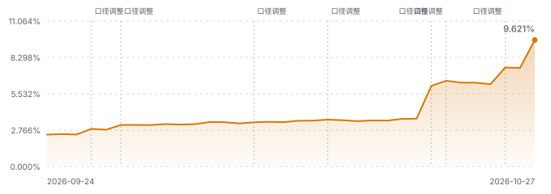
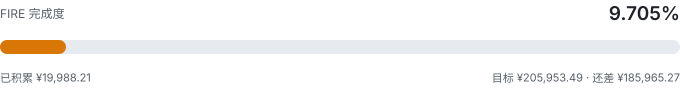
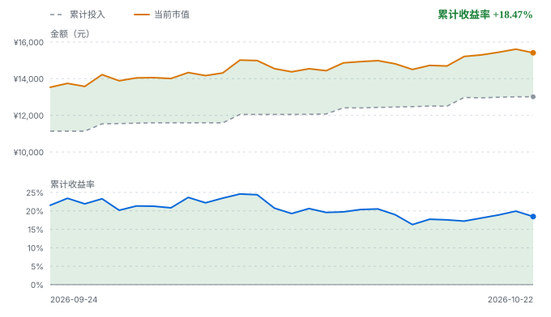

# FIRE-Progress

> 我的 FIRE 进度看板。只统计三项长期不动用的资产：比特币、标普500基金、纳指100基金。
> 持仓来自两个公开仓库 + 东方财富的公开净值接口，由 GitHub Actions 每小时更新，不需要任何密钥。
>
> 各数字的出处见 [详细文档](#详细文档)：五份文档，一份讲[**为什么做这件事**](docs/FIRE-WHY.md)，四份分别覆盖生活规划、时间线、支出清单与实现细节。

<!-- FIRE:START -->

**更新时间**：2026-10-29 10:10:23+08:00

**比特币快照**：2026-10-25（4 天前）　|　**基金净值日**：2026-10-27

### 进度曲线

> 每个点是当天的完成度原值，按 `data/history.json` 连线，不回填、不重算。
>
> 竖虚线是口径调整日：那天 FIRE 目标变了，曲线因此出现台阶。目标值逐日记在 `data/history.json` 里，可以查到。
>
> ⚠️ **分子口径也有过变化**，但不会画竖线（竖线只标分母）：2026-10-27 起分子纳入纳指100（当日跳升约 2.1 个点属口径变化，非资产增长）。纳入后分子变大、进度跳升，那不是资产增长。

> 完成度 = 当前资产 ÷ FIRE 目标。资产随行情走，目标随口径走；月开销、提取率或兼职收入改一项，百分比就会变，未必是资产涨跌。

| 指标 | 数值 |
| --- | ---: |
| 🎯 FIRE 目标资产 | ¥205,953.49 |
| ☕ 兼职净收入（月） | ¥723.00 |
| 🧾 组合需覆盖（月） | ¥738.00 |
| 💰 当前资产 | ¥19,988.21 |
| 📈 完成度 | **9.705%** |
| ⏳ 距离目标 | ¥185,965.27 |
| ⏱️ 每小时被动收入（按预期年化） | ¥0.24 |

FIRE 后月开销明细 · 牡丹江 · 单人 · 租房 · 极简

共 **17 项**，合计 **¥1,461.00/月**。

**分类汇总**

| 分类 | 月支出 | 占比 |
| --- | ---: | ---: |
| 住房与水电燃气 | ¥712.00 | 48.7% |
| 日常开销 | ¥532.00 | 36.4% |
| 医疗与应急 | ¥217.00 | 14.9% |
| **合计** | **¥1,461.00** | 100.0% |

**逐项明细**

**住房与水电燃气** · ¥712.00/月 · 占 48.7%

| 项目 | 月支出 | 占总计 |
| --- | ---: | ---: |
| 房租 | ¥500.00 | 34.2% |
| 取暖费 | ¥75.00 | 5.1% |
| 物业费 | ¥15.00 | 1.0% |
| 水费 | ¥12.00 | 0.8% |
| 电费 | ¥55.00 | 3.8% |
| 燃气/液化气 | ¥35.00 | 2.4% |
| 家电维修与更换摊销 | ¥20.00 | 1.4% |

**日常开销** · ¥532.00/月 · 占 36.4%

| 项目 | 月支出 | 占总计 |
| --- | ---: | ---: |
| 网络与手机 | ¥30.00 | 2.1% |
| 食品 | ¥300.00 | 20.5% |
| 饮用水 | ¥15.00 | 1.0% |
| 日用品 | ¥22.00 | 1.5% |
| 交通 | ¥30.00 | 2.1% |
| 探亲与返乡交通 | ¥100.00 | 6.8% |
| 衣物 | ¥30.00 | 2.1% |
| 杂项（快递与小额） | ¥5.00 | 0.3% |

**医疗与应急** · ¥217.00/月 · 占 14.9%

| 项目 | 月支出 | 占总计 |
| --- | ---: | ---: |
| 医疗自付预留 | ¥80.00 | 5.5% |
| 应急与物价缓冲 | ¥137.00 | 9.4% |

**兼职收入** · 咖啡师 FIRE · 兼职

15.0 元/小时 × 每周 12 小时 = 52.0 小时/月（13.0 个工作日）

| 项目 | 金额 |
| --- | ---: |
| 毛收入 | ¥780.00 |
| 减：交通（往返公交） | −¥26.00 |
| 减：餐食增量 | −¥25.00 |
| 减：装备摊销 | −¥6.00 |
| **净收入** | **¥723.00** |

> 组合需要覆盖：¥1,461.00 − ¥723.00 = **¥738.00/月**。
>
> 只扣上班多出来的开销：餐食算的是「在外面吃比在家做贵多少」，不是整顿饭钱，家里那顿已经算在食品里，全额扣等于把生活费算两遍。
>
> 通勤 1.0 小时不算工资，但要占时间：每月实际占用 65.0 小时，等效时薪 ¥11.12（名义净时薪 ¥13.90）。

**一次性支出**（不进入 FIRE 目标，落地那年发生一次）：

| 项目 | 金额 |
| --- | ---: |
| 租房押金 | ¥1,000.00 |
| 搬家与长途运输 | ¥3,000.00 |
| 家具家电添置 | ¥8,000.00 |
| 过冬装备 | ¥3,000.00 |
| **合计** | **¥15,000.00** |

> 月开销 = 上面各项相加；`FIRE 目标 = (月开销 − 兼职净收入) × 12 ÷ 提取率`。每项的依据见 [config.yaml](config.yaml) 和 [docs/FIRE-LIFE-PLAN.md](docs/FIRE-LIFE-PLAN.md)。
>
> 一次性支出不摊进月开销：它不产生持续现金流，摊进去会同时抬高月开销和目标。
>
> 加上一次性支出，总共需要 **¥220,953.49**。

### 资产构成

| 资产 | 市值 | 占比 |
| --- | ---: | ---: |
| 比特币 | ¥14,562.22 | 72.9% |
| 标普500基金 | ¥898.30 | 4.5% |
| 纳指100基金 | ¥4,527.69 | 22.7% |
| **合计** | **¥19,988.21** | 100.0% |

> 只算长期不动用的钱：比特币、标普500基金、纳指100基金。日常现金和活期不算。所以卖出后进度下跌未必是亏了，可能只是钱变成了现金，详见下方「计入范围」。

比特币计价：**0.02724339 BTC** × ¥534,523.21 = ¥14,562.22

比特币持仓明细（快照 2026-10-25，手动更新）

| 账户 | 数量 (BTC) | 均价 (USD) |
| --- | ---: | ---: |
| 币安 | 0.01016529 | $69,618.88 |
| 欧易 | 0.0170781 | $69,545.60 |

标普500基金持仓明细

| 基金 | 市值 | 累计投入 | 持有份额 | 最新净值 |
| --- | ---: | ---: | ---: | ---: |
| 摩根标普500 A | ¥448.97 | ¥449.55 | 263.90 | 1.7013 |
| 摩根标普500 C | ¥449.32 | ¥450.00 | 266.74 | 1.6845 |

纳指100基金持仓明细（净值日 2026-10-26，份额固定，已停止定投）

| 基金 | 市值 | 累计投入 | 持有份额 | 最新净值 |
| --- | ---: | ---: | ---: | ---: |
| 天弘纳斯达克100指数发起(QDII)A | ¥2,695.55 | ¥2,317.08 | 1330.28 | 2.0263 |
| 国泰纳斯达克100指数 | ¥1,277.99 | ¥1,300.01 | 287.06 | 4.4520 |
| 华安纳斯达克100ETF联接(QDII)A | ¥554.15 | ¥560.13 | 68.00 | 8.1493 |

### 投入与盈亏

| 指标 | 数值 |
| --- | ---: |
| 累计投入本金 | ¥17,739.08 |
| 当前市值 | ¥19,988.21 |
| 累计盈亏 | ¥2,249.13 |
| **累计收益率** | **+12.68%** |

> 比特币本金按持仓备注的「均价 $xx/BTC」推算，用当前汇率折成人民币，和真实买入成本有偏差；标普500本金取 sp500-dca 的累计投入。

### 收益曲线

> 上面板：累计投入（虚线）和市值（实线），缺口就是盈亏。下面板：累计收益率，纵轴含 0。
>
> 加仓会让收益率下降，因为本金变大、盈亏不变。所以收益率掉了不一定是亏，可能只是又投了一笔。上面板能看出本金哪天跳升。
>
> 上面板纵轴不从 0 起，否则缺口会被压成一条线，斜率也不代表涨跌幅。下面板含 0，正负可以直接读。
>
> 起点 2026-09-24。早期数据由两个持仓仓库的历史文件重建，比特币统一按当前汇率折算，绝对值和真实本金有误差，趋势可信；之后每天由 Actions 记录。

### 每小时被动收入

| 资产 | 市值 | 权重 | 预期年化 | 每小时 |
| --- | ---: | ---: | ---: | ---: |
| 比特币 | ¥14,562.22 | 72.9% | 12.0% | ¥0.199 |
| 标普500基金 | ¥898.30 | 4.5% | 6.0% | ¥0.006 |
| 纳指100基金 | ¥4,527.69 | 22.7% | 6.0% | ¥0.031 |
| **合计** | **¥19,988.21** | 100.0% | **10.4%** | **¥0.237** |

换算：每小时 **¥0.24** · 每天 **¥5.68** · 每月 **¥172.75** · 每年 **¥2,073.03**

> 按当前持仓，这笔被动收入相当于月开销的 **11.8%**（月开销 ¥1,461.00）。
>
> 这是按假设算出来的数，不是承诺。加权年化 10.4% 由各资产按市值加权得到，假设写在 `config.yaml` 的 `expected_return` 段，改它不影响 FIRE 目标。
>
> 区间跨度大：悲观（比特币 0%、标普500基金 3%、纳指100基金 3%）每小时 ¥0.019，乐观（比特币 25%、标普500基金 9%、纳指100基金 9%）¥0.471。因为各资产的回报率假设本身就宽：比特币没有可锚定的现金流，长期回报率只能猜。
>
> 也别把 10.4% 当成能花的钱。预期回报是「平均能涨多少」，提取率是「能安全花多少」：按 4.3% 提取率算，同样这笔资产每小时 ¥0.098、每月 ¥71.62。
>
> 差额是给波动留的：平均回报为正，但路径上先腰斩一次，按平均回报安排支出就会在中途卖掉筹码。比特币单年 ±50% 是常态，两个数要一起看。

### 线性外推

按近 30 天的平均增速（日均 +¥205.77）线性外推，**约 2.5 年**后达到目标（2029-04-19）。

> 线性外推不是预测：它假设近期增速会一直持续，实际会随行情、定投额度和开销变化。

数据源：[SayangChun/0.1BTC](https://github.com/SayangChun/0.1BTC)（比特币持仓，每周手动更新）、[SayangChun/sp500-dca](https://github.com/SayangChun/sp500-dca)（标普500 持仓）、东方财富（纳指100 净值，份额固定）· 行情：binance:data-api.binance.vision · 汇率：open.er-api.com

<!-- FIRE:END -->

## 详细文档

看板上每个数字都能追到出处。五份文档各管一层：

| 文档 | 回答什么 | 使用场景 |
| --- | --- | --- |
| [**为什么 FIRE**](docs/FIRE-WHY.md) | **为什么做这件事**——动机、对工作的看法、对「这是逃避」这类质疑的回应 | 理解立场。**不参与计算**，不随口径变动 |
| [**FIRE 生活规划书**](docs/FIRE-LIFE-PLAN.md) | **怎么生活**——月开销 ¥1,461 的 17 项逐项依据、租房与饮食、不参保的代价 | 改预算、核对物价、评估定居城市 |
| [**两段式路线图**](docs/FIRE-ROADMAP.md) | **什么时候走、能撑多久**——2029-06 出发、阶段 A 长度敏感性、临界收益率 | 调整时间线、比较兼职方案 |
| [**支出候选清单**](docs/FIRE-SPENDING-CHECKLIST.md) | **花了什么**——130+ 项候选支出，逐项标注计入 / 不计入 / 待定 | 怀疑漏项、想加一笔新支出 |
| [**实现方案**](docs/DESIGN.md) | **怎么算的**——数据源、口径落点、自动化流程、README 生成规则 | 改代码、审计口径、接入新资产 |

后四份文档共用 [`config.yaml`](config.yaml) 的口径：改金额改 `life_plan`，改时间线改 `timeline`，均无需改动文档。**第一份（为什么 FIRE）不参与任何计算**，改口径时不用动它。但**改完需同步对应章节**，否则文档与看板会不一致（2026-10-27 曾出现执行清单仍写「赎回纳指」、而决定已改为不卖）。

## 计算口径

| 参数 | 取值 |
| --- | ---: |
| 月开销 | ¥1,461（由生活规划逐项推导） |
| 兼职净收入 | ¥723.00/月（咖啡师 FIRE） |
| **组合需覆盖** | **¥738.00/月** |
| 提取率 | 4.3% |
| **FIRE 目标资产** | **¥205,953.49** |

公式：`FIRE 目标 = (月开销 − 兼职净收入) × 12 ÷ 提取率`，`完成度 = 当前资产 ÷ FIRE 目标`。

月开销不是拍出来的，由 [`config.yaml`](config.yaml) 的 `life_plan` 逐项相加得到，每项都标了依据。改一项，目标自动重算。公式的代码落点、校验规则与「为什么这么算」见 [实现方案 §1](docs/DESIGN.md)。

兼职净收入对应咖啡师 FIRE（`fire.labor_income`）：FIRE 后继续做低压力、随时能停的兼职，收入抵掉一部分开销，资产就不必覆盖全部。只扣上班多出来的成本（通勤、在外吃饭的差价、装备摊销）。把 `enabled` 改成 `false` 就退回传统 FIRE（目标 ¥407,720.93），两种口径随时可比。

口径变更记录：

| 日期 | 改了什么 | 目标 |
| --- | --- | ---: |
| 2026-09-27 | 月开销从 ¥2,000 改为逐项推导，基准城市定为牡丹江（占位） | ¥558,139.53 → ¥420,558.14 |
| 2026-10-20 | 改为咖啡师 FIRE，兼职按牡丹江非全日制最低工资 ¥18.8、每周 2 天 × 4 小时 | → ¥252,167.44 |
| 2026-10-21 | 移除全部医保 / 社保（居民医保 ¥33、龙江惠民保 ¥13） | → ¥239,330.23 |
| 2026-10-25 | 兼职时薪 ¥18.8 → ¥15、每周 2 天 → 3 天 | → ¥205,953.49 |
| 2026-10-27 | 建立两段式框架。**目标不变**——新增的是「这笔钱够撑多久」这个口径，不参与进度计算 | → ¥205,953.49（不变） |
| 2026-10-27 | 纳入纳指100（018043 / 160213 / 040046，三只场外 QDII，已停止定投）。**分子变大、目标不变**：进度从 7.50% 跳到 9.62%，那是统计范围变了，不是资产涨了 | → ¥205,953.49（不变） |
| 2026-10-29 | 定居城市由「省内占位、未定」改为**确定为牡丹江**，保留将来调整的可能。**目标不变**——月开销一直按牡丹江口径计算，本次只改定位与表述，不动任何金额 | → ¥205,953.49（不变） |

> 每次变更都会让进度曲线出现台阶，那是分母变了，不是资产涨了。`data/history.json` 逐日记录了当时的 `target_cny`，台阶可查。
>
> 最后一次省了钱，也放大了风险：住院 100% 自付，见规划书 §5。

## FIRE 生活规划

FIRE 后定居**牡丹江**（2026-10-29 确认）：单人、租房、极简生活。**选定不等于锁死**——仍保留调整的可能，换城市按规划书 §2.4 重算。

| 项目 | 结论 |
| --- | --- |
| 定居地 | **牡丹江**（2026-10-29 确认，保留调整可能） |
| 生活基准 | 牡丹江 · 单人 · 租房 · 极简 |
| 月开销 | ¥1,461（17 项） |
| 兼职净收入 | ¥723.00（每周 3 天 × 4 小时，时薪 ¥15） |
| 组合需覆盖 | ¥738.00 |
| FIRE 目标 | ¥205,953.49 |
| 一次性落地支出 | ¥15,000 |
| 含一次性支出的资金需求 | ¥220,953.49 |
| 对照：常规档 | 月 ¥2,754 → 目标 ¥566,790.70 |
| 对照：传统 FIRE（无兼职） | 目标 ¥407,720.93 |

完整规划见 **[docs/FIRE-LIFE-PLAN.md](docs/FIRE-LIFE-PLAN.md)**：

- **为什么是牡丹江**：与省内其他城市（鹤岗 / 伊春 / 佳木斯 / 大庆 / 黑河 / 哈尔滨）的房价、租金、取暖费对比，含按建筑面积还是使用面积收费的换算；以及换城市要改哪些字段（§2.4）
- **住房**：租房方案，以及「租 vs 买」的测算。牡丹江买房隐含净回报率 2.72%，低于 4.3% 提取率，租房更划算，买房合计多约 ¥64,052
- **每天饮食**：16:8 两餐、不炒菜的「一锅公式」、逐项购物篮与营养达标表（锌 78% 是唯一短板）、东北囤冬菜
- **医疗与保障**：2026-10-21 起不参加任何医保 / 社保，住院 100% 自付，靠专项应急金兜底（§5.2–5.4）
- **已排除的支出**：父母赡养、人情往来、旅行、手机与电脑换新、体检牙科、意外险等，逐项确认后不计入，代价记在 §6.1
- **敏感性分析**：每多花 ¥100/月，目标多约 ¥27,907；兼职工时不确定，2 / 3 / 4 天对应目标 ¥276k / ¥206k / ¥136k
- **风险清单与执行时间表**

> ⚠️ ¥1,461 是下限，不是中位数。约 ¥75/月（体检、牙科）属于 30 年内几乎必然发生的支出，
> 不计入的话目标看着是 ¥205,953，真实更可能落在 ¥226,884 上下。130+ 项候选清单见
> **[docs/FIRE-SPENDING-CHECKLIST.md](docs/FIRE-SPENDING-CHECKLIST.md)**。每 ¥10/月约等于目标 ±¥2,791。
>
> ⚠️ 前提是不交社保、不参加任何医保，所以没有养老金，住院全自付，唯一防线是专项医疗应急金（¥50k–100k）。
> 代价与不可逆性记在规划书 §5，那里也讨论了把提取率从 4.3% 收紧到 4.0%（目标 ¥221,400）的选项。

## 两段式路线

上面的 FIRE 目标是**永续**口径——假设兼职一直做下去、资产永不耗尽。但实际计划是**两段式**的：

| | 阶段 A | 阶段 B |
| --- | --- | --- |
| 地点 | 牡丹江 | 北京 |
| 性质 | 一个人独立生活 | 回归家庭，看护长辈 |
| 收入 | 咖啡师式兼职（¥15–17/时） | 无 |
| 支出来源 | 兼职收入 + 本金消耗 | 家庭共同资金 |
| 退出条件 | 长辈病情加重 → 回京，此后不再回来 | 长辈离世 → 继承 → 在北京生活 |

阶段 A **有明确的退出条件，所以不需要永续**。按年金现值算，2029-06 毕业时约 **¥9.4 万**本金：

| 方案 | 净支出 | 可支撑年数 | 结束年龄 |
| --- | ---: | ---: | ---: |
| 每周 3 天 × ¥15（当前口径） | ¥738/月 | **14.5 年** | 36.5 岁 |
| 每周 4 天 × ¥17 | ¥348/月 | **81.7 年** | 103.7 岁 |

**3 天只够撑 14.5 年，4 天覆盖所有可能长度。** 分界线是外公 92 岁——而这件事无法提前知道。

临界收益率（永续所需的最低实际收益率）：3 天 × ¥15 需 **8.86%**（高于标普500 长期实际回报 6.75%，那是在赌），4 天 × ¥17 只需 **4.18%**（低于提取率，保守假设下自动成立）。

完整推演见 **[docs/FIRE-ROADMAP.md](docs/FIRE-ROADMAP.md)**：时间线、阶段 A 长度敏感性、兼职方案对比与排除项、家庭资源定位。

> ⚠️ 这一段**不改变**上面的 FIRE 目标与完成度。它回答的是另一个问题：这笔钱够不够撑到该回去的那天。

## 计入范围

- ✅ [0.1BTC](https://github.com/SayangChun/0.1BTC) 仓库中的比特币持仓
- ✅ [sp500-dca](https://github.com/SayangChun/sp500-dca) 仓库中的标普500基金市值
- ✅ 纳指100 场外基金（018043 / 160213 / 040046）：份额写在 `config.yaml` 的 `sources.ndx100`，净值抓东方财富公开接口
- ❌ 日常现金、活期存款、其他币种、其他一切资产

划线标准是「长期不动用」，不是「能不能变现」。日常现金要随时周转，所以不算。这条标准的来由、以及历史上哪些资产被纳入又移出（应急金、纳指100），见 [实现方案 §1.4](docs/DESIGN.md)。

> ⚠️ **配置仍然偏斜**：比特币占**七成以上**，而真正「稳」的标普500 只有**四个百分点**——
> 具体数字见上方自动生成的「资产构成」表。
> 「非比特币敞口」虽然已经到四分之一，但其中大部分是纳指——**纳指不算「稳」**：
> 它和标普500 相关性 0.9 以上，都是美股成长敞口，只是纳指更偏科技、波动更大。
> 而 `asset_allocation.sp500_target_range` 的目标是 25–30%，缺口主要在这里。
> 占比由 config 控制，**只做展示，不影响目标**。再平衡路径见 [docs/FIRE-ROADMAP.md](docs/FIRE-ROADMAP.md) §2.3。

推论：卖出资产不会让进度失真，卖出后钱离开这个范围才会。

| 情形 | 进度 | 是否真实 |
| --- | --- | --- |
| 工资入金 / 买入 | ↑ | 真实增长 |
| 池内互换（卖 BTC 买标普500） | → 不变 | 正常 |
| 卖出后把钱花掉 | ↓ | 真实减少 |
| 卖出后变成现金放着 | ↓ | 假信号：资产没少，只是换了形式 |

> 进度跌了，先看钱去哪了。变成现金的话，那是口径边界，不是资产减少。

## 数据节奏

| 资产 | 数据来源 | 更新方式 | 时效 |
| --- | --- | --- | --- |
| 比特币 | [0.1BTC](https://github.com/SayangChun/0.1BTC) 的 `data/holdings.csv` | 每周手动更新 | 数量有延迟，非实时 |
| 标普500基金 | [sp500-dca](https://github.com/SayangChun/sp500-dca) | Actions 每小时自动抓取 | 净值 T+1 晚间披露 |
| 纳指100基金 | 东方财富 `pingzhongdata` 公开接口；份额在 [`config.yaml`](config.yaml) 的 `sources.ndx100` | Actions 每小时自动抓取 | 净值 T+1/T+2 披露；**已停止定投，份额固定** |
| FIRE 生活规划 | [`config.yaml`](config.yaml) 的 `life_plan` | 手动维护 | 改一项就改变目标，建议每年复核 |

> 比特币数量来自手动维护的周度快照，不代表实时持仓。顶部会显示快照日期和距今天数，超过 14 天自动告警。市值仍按最新行情折算，所以是「数量滞后、估值实时」。
>
> **纳指100 只需录一次份额**——已停止定投，份额不会自己变；净值每天自动抓，不需要任何手动维护。只有将来申购或赎回时才改 `shares`。
>
> 月开销是目标的分母，没法全自动。物价会变（取暖费、房租、保费每年都可能调），建议每年 9–10 月复核一次 `life_plan`，跑一遍 `python tests/test_life_plan.py` 确认口径没坏。

## 自动化

GitHub Actions 每小时轮询一次：读两个持仓仓库、抓行情和汇率、重算进度、更新本文件。结果没有实质变化就不提交，避免刷屏。

频率定得高，是因为 GitHub 的定时任务常比计划时间晚几小时触发。每小时跑一次，最大滞后约 1 小时。

---

*本仓库为个人资产记录，不构成任何投资建议。数据为个人口径，可能与实际存在偏差。*
